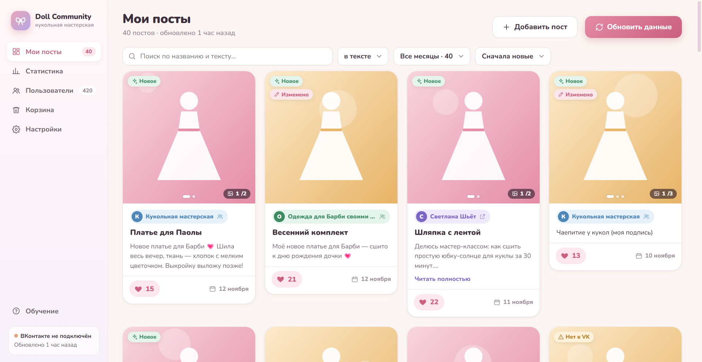
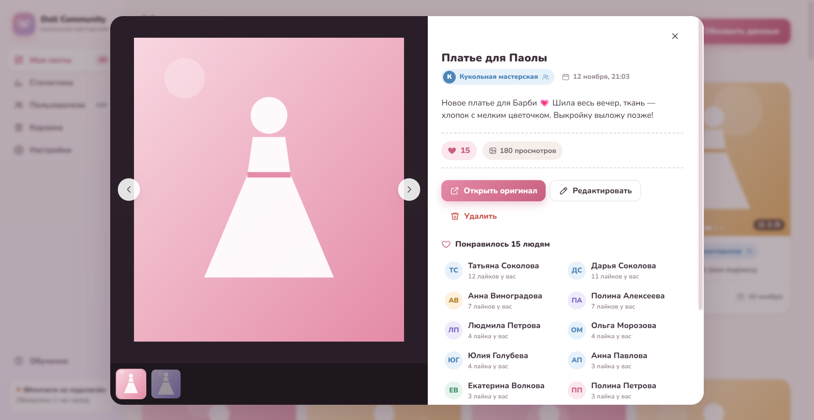
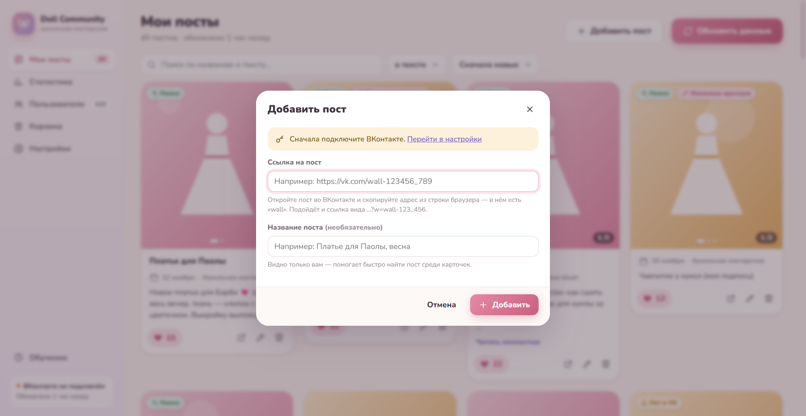
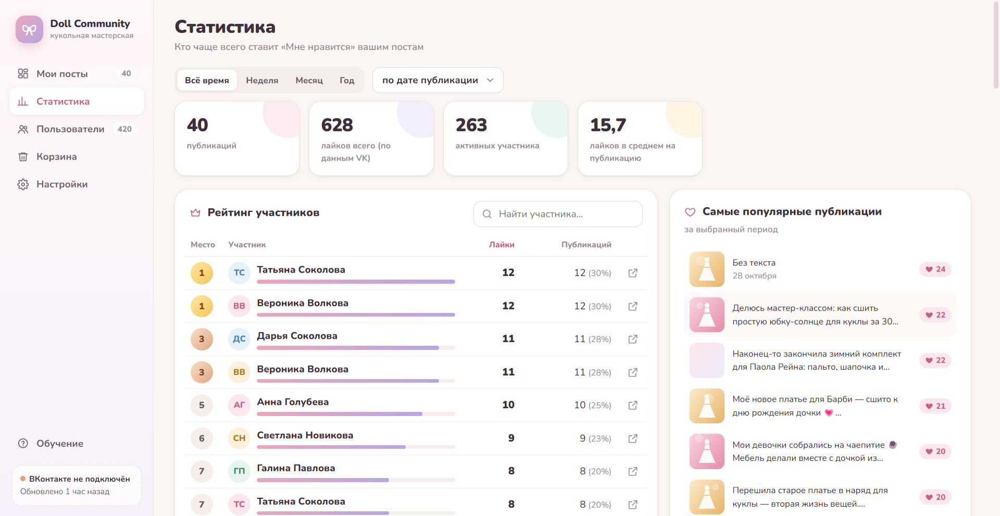
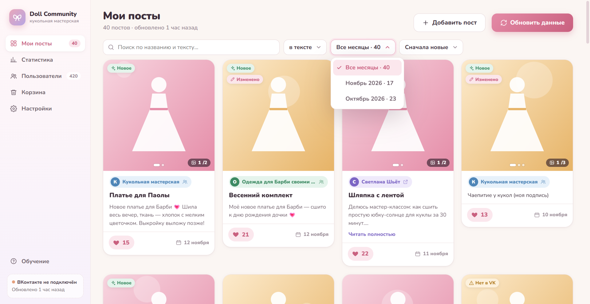
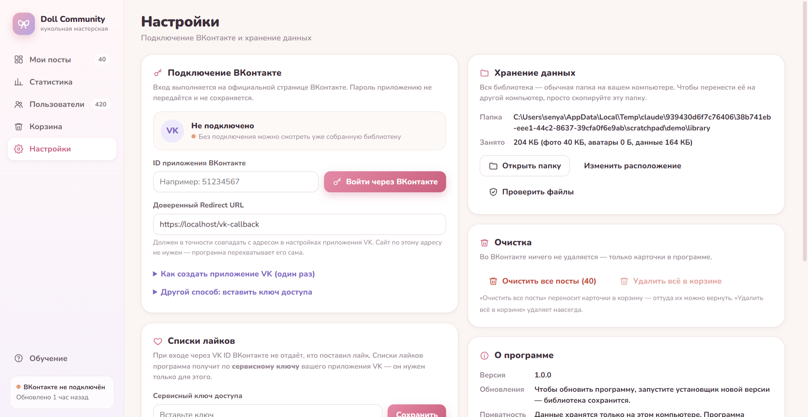

<div align="center">

# 🎀 VK Doll Community

**Ваши посты ВКонтакте и все, кто их лайкает, — в одной уютной программе для Windows.**

Добавляйте свои посты по ссылке, давайте им названия, смотрите фото, тексты и тех, кто поставил «Мне нравится».
Всё хранится локально на вашем компьютере.




</div>

> **🤖 Проект полностью сделан с помощью Claude** (Anthropic) в Claude Code: архитектура, код, интерфейс, тесты, установщик и эта страница.

---

## ✨ Возможности

| | |
|---|---|
| ➕ **Добавить пост** | Вставьте ссылку на пост (`vk.com/wall-123_456` или `…?w=wall-123_456`) и, если хотите, название — оно видно только вам. |
| 🔄 **Обновить данные** | Проверяет только добавленные посты: текст, фото, лайки. Стены сообществ не листаются, лишнее не скачивается. |
| 📅 **Фильтр по месяцу** | Быстро показать посты за нужный месяц — рядом указано, сколько их. |
| 🖼️ **Фото-слайдер** | В карточке можно листать все фото поста; в подробном просмотре — галерея с миниатюрами. |
| ❤️ **Кто лайкнул** | В карточке поста сразу виден список лайкнувших; рейтинг самых активных — в «Статистике». |
| ✏️ **Свои правки** | Название, текст, дата и фото меняются только у вас и не затираются обновлением. |
| 🗑️ **Корзина** | Вернуть всё или удалить навсегда; в настройках — «Очистить все посты». |
| 🔒 **Приватность** | Данные — обычная папка на диске; ключи VK зашифрованы средствами Windows (DPAPI). |

## 📸 Скриншоты

<table>
<tr>
<td width="50%"><br><sub>Пост: галерея, текст, статистика и список лайкнувших</sub></td>
<td width="50%"><br><sub>Добавление поста по ссылке с названием</sub></td>
</tr>
<tr>
<td><br><sub>Статистика: рейтинг участников и популярные посты</sub></td>
<td><br><sub>Поиск, фильтр по месяцу и сортировка</sub></td>
</tr>
<tr>
<td><br><sub>Настройки: вход VK ID, списки лайков, очистка</sub></td>
</tr>
</table>

<sub>На скриншотах — демо-данные (`test/make-demo.js`), не настоящие люди.</sub>

## 🚀 Быстрый старт

1. Скачайте и запустите установщик `VKDollCommunity-Setup-<версия>.exe` — права администратора не нужны.
2. **Настройки → Подключение ВКонтакте**: укажите ID своего приложения VK ID и войдите на официальной странице VK.
3. **Настройки → Списки лайков → Войти на vk.com** — один раз войдите в ВКонтакте. Без входа видны лайки только открытых постов и только первые ~350 человек.
4. **Мои посты → Добавить пост** — вставьте ссылку. Готово!

<details>
<summary><b>Как создать приложение VK ID (один раз)</b></summary>

- Откройте [VK ID для бизнеса](https://id.vk.com/about/business/go) и создайте приложение, платформа — **Web**.
- Базовый домен: `localhost`, доверенный Redirect URL: `https://localhost/vk-callback` (сервер не нужен — программа перехватывает адрес сама).
- Скопируйте **ID приложения** в настройки программы.

</details>

<details>
<summary><b>Почему нужен вход на vk.com</b></summary>

Приложениям VK ID ВКонтакте отвечает на часть методов ошибкой 1051 («Method is not available for this profile type») — и для ключа пользователя, и для сервисного ключа:
- `wall.getById` — программа находит пост на стене через `wall.get` двоичным поиском (`desktop/wallfind.js`) и запоминает его место;
- `likes.getList` — списки лайков читаются со страницы «Оценили» (`m.vk.ru/like?act=members&object=wall…`, `desktop/weblikes.js`), короткие имена переводятся в id через `users.get`. Без входа на vk.com страница показывает только открытые посты и только первые ~350 человек; при неполном списке уже известные лайки не удаляются.

Сервисный ключ можно указать для старых приложений, созданных на vk.com/dev: тогда программа сначала попробует его.

</details>

## 🛠️ Для разработчиков

```bash
npm install
npm start          # запуск из исходников
npm test           # автотесты (VK подменяется фальшивым сервером)
npm run test:ui    # проверка интерфейса в настоящем окне
npm run dist       # установщик в dist/
```

Демо-данные без VK:

```bash
node test/make-demo.js C:\temp\vkd-demo 150
set VKD_TEST_ROOT=C:\temp\vkd-demo && npx electron .
```

| Где | Что |
|---|---|
| `desktop/main.js` | окно, IPC, вход VK ID, зашифрованные ключи, протокол `vkd://` для локальных фото |
| `desktop/posts.js` | «Добавить пост», название, «Очистить все посты», очистка корзины |
| `desktop/wallfind.js` | получение поста: `wall.getById` или поиск на стене через `wall.get` |
| `desktop/sync.js` | «Обновить данные»: посты → лайки → профили → фото → аватары |
| `desktop/vk.js` | клиент VK API: ~3 запроса/с, повторы, понятные ошибки |
| `desktop/storage.js` | JSON-хранилище: атомарная запись, `.prev`, миграции |
| `src/js/*` | экраны: мои посты, пост, статистика, пользователи, корзина, настройки, обучение |

Подробная карта проекта — в [AGENTS.md](AGENTS.md).

Данные: `%APPDATA%\VK Doll Community` (библиотека, фото, журнал). Зашифрованные ключи VK: `%LOCALAPPDATA%\VK Doll Community`.

---

<div align="center">
<sub>Сделано с 💗 и <b>Claude</b></sub>
</div>
